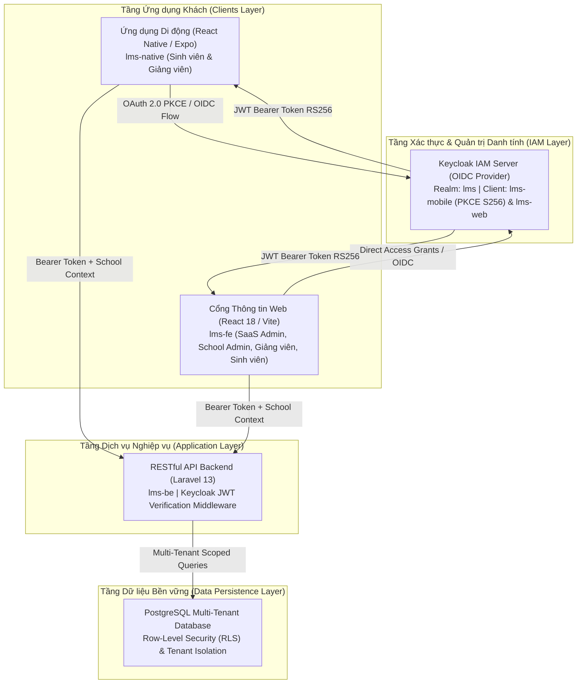

# Enterprise Learning Management System (LMS) Multi-Tenant Platform

Nền tảng Quản lý Học tập và Quản trị Đào tạo Đa trường (Multi-Tenant Learning Management System) phục vụ các trường đại học thành viên, tích hợp hệ sinh thái đa kênh (Cổng thông tin Web 4 cấp độ và Ứng dụng Di động Native), hệ thống xác thực tập trung **Keycloak Identity and Access Management (OIDC / PKCE)** và cơ sở dữ liệu **PostgreSQL** hỗ trợ phân vùng dữ liệu theo từng cơ sở đào tạo.

---

## 1. Giới thiệu Nền tảng (Platform Overview)

Nền tảng LMS được thiết kế để giải quyết bài toán quản trị học vụ phân tán cho nhiều trường đại học trên cùng một hạ tầng điện toán đám mây. Hệ thống hỗ trợ quản lý đào tạo theo học chế tín chỉ, theo dõi lộ trình học tập toàn khóa của sinh viên, tổ chức giảng dạy và quản lý chuyên cần thời gian thực.

### Các trụ cột công nghệ cốt lõi

* **Kiến trúc Đa trường (Multi-Tenant Architecture)**: Tách biệt hoàn toàn dữ liệu học vụ, sinh viên, giảng viên và chương trình đào tạo giữa các trường đại học thành viên (Trường ĐH Công Thương TP.HCM - HUIT và Trường ĐH Bách Khoa TP.HCM - HCMUT) trên cùng một cơ sở dữ liệu dùng chung.
* **Xác thực Tập trung Chuẩn Doanh nghiệp (Keycloak IAM)**: Toàn bộ phiên làm việc của người dùng trên Web và Mobile được xác thực tập trung qua giao thức **OpenID Connect (OIDC)** và **OAuth 2.0 with PKCE (RFC 7636)**, bảo vệ bằng mã hóa token RS256.
* **Hệ sinh thái Đa nền tảng Đồng bộ**: Trải nghiệm nhất quán giữa Cổng thông tin Web chuyên sâu dành cho Quản trị viên / Giảng viên / Sinh viên và Ứng dụng Di động tối ưu hóa cho học vụ hàng ngày.
* **Bảo mật và Phân quyền Cấp độ Dữ liệu**: Áp dụng cơ chế **PostgreSQL Row-Level Security (RLS)** kết hợp Tenant Scope Middleware, ngăn chặn tuyệt đối tình trạng truy cập chéo dữ liệu giữa các cơ sở đào tạo.

---

## 2. Kiến trúc Hệ thống Tổng thể (System Architecture)

Hệ thống được thiết kế theo mô hình kiến trúc phân tầng (Multi-tier Architecture) hỗ trợ Multi-Tenant, bảo đảm tính sẵn sàng cao và khả năng mở rộng độc lập giữa các phân hệ:



### Luồng Bảo mật và Xác thực (Authentication Flow)

1. Thiết bị di động khởi tạo chuỗi ngẫu nhiên `code_verifier` và mã hóa SHA-256 tạo thành `code_challenge` theo chuẩn **RFC 7636 (PKCE)**.
2. Ứng dụng chuyển hướng xác thực đến Keycloak Authorization Endpoint tại Realm `lms`.
3. Sau khi xác thực danh tính thành công, Keycloak trả về Authorization Code. Ứng dụng gửi kèm `code_verifier` để đổi lấy **JWT Access Token**.
4. Mọi yêu cầu nghiệp vụ gửi tới Backend API đều đính kèm JWT Bearer Token. Backend Middleware xác thực chữ ký RS256 qua Keycloak Public Key, trích xuất `school_code`, `roles`, `user_code` và thiết lập ngữ cảnh truy vấn dữ liệu tương ứng.

---

## 3. Hệ sinh thái Phân hệ & Tính năng Nền tảng (Platform Modules)

Hệ thống bao gồm 3 phân hệ cấu thành độc lập được phối hợp chặt chẽ:

### 3.1. Phân hệ Ứng dụng Di động (`lms-native`)

Ứng dụng di động xây dựng trên nền tảng **React Native (Expo SDK 58)** hỗ trợ đa nền tảng (Android, iOS và Web), cung cấp đầy đủ các tiện ích học vụ dành cho sinh viên:

* **Trang chủ Học vụ Cá nhân hóa (Student Dashboard)**:
  * Tự động nhận diện trường đào tạo (**Dynamic Multi-Tenant Branding**): Tự động chuyển đổi logo, bảng màu chủ đạo, tiêu đề trường và đường dây nóng hỗ trợ theo trường sinh viên theo học (HUIT hoặc HCMUT).
  * Thẻ tổng quan kết quả học tập: Tra cứu nhanh Điểm trung bình tích lũy (GPA thang 4 và thang 10), số tín chỉ đã tích lũy trên tổng số tín chỉ yêu cầu, xếp loại học lực theo quy chế tín chỉ.
  * Thẻ lịch học trong ngày: Cập nhật ca học tiếp theo, phòng học, mã lớp học phần và giảng viên phụ trách.
* **Chương trình Đào tạo Khung (Curriculum & Academic Roadmap)**:
  * Hiển thị lộ trình học tập toàn khóa 8 học kỳ theo từng ngành đào tạo (Công nghệ thông tin: 151 TC, Kế toán: 145 TC, Khoa học Máy tính Bách Khoa: 142 TC).
  * Trực quan hóa tiến độ: Phân định rõ ràng học phần bắt buộc, tự chọn và trạng thái học phần đã tích lũy (nhãn xanh **"Đã đạt"**).
* **Thời khóa biểu & Lịch học (Schedule & Timetable)**:
  * Lịch học biểu diễn theo tuần hoặc từng ngày cụ thể, chi tiết thời gian bắt đầu, kết thúc, cơ sở đào tạo và phòng học.
* **Điểm danh & Giám sát Chuyên cần (Attendance Management)**:
  * Điểm danh trực tiếp và theo dõi lịch sử chuyên cần, tỷ lệ có mặt theo từng lớp học phần.
* **Tài chính & Dịch vụ Trực tuyến**:
  * Tra cứu công nợ học phí, biên lai thu tiền học phí điện tử và lịch sử giao dịch.
  * Tham gia khảo sát đánh giá chất lượng đào tạo và cập nhật tin tức thông báo nhà trường.
* **Trợ lý Học vụ AI Đa trường (AI Tutor)**:
  * Tích hợp trợ lý trí tuệ nhân tạo hỗ trợ giải đáp quy chế đào tạo, thông tin phòng ban và kế hoạch học tập theo đúng cơ sở đào tạo của người dùng.

---

### 3.2. Cổng Thông tin Quản trị & Nghiệp vụ Web (`lms-fe`)

Cổng thông tin Web xây dựng bằng **React 18 và Vite**, phục vụ 4 nhóm người dùng chuyên biệt:

* **Cổng Quản trị Toàn hệ thống (SaaS Super Admin)**:
  * Quản lý danh mục các trường đại học thành viên (Tenants).
  * Thiết lập cấu hình hệ thống toàn cục, giám sát tài nguyên và phân bổ cơ sở dữ liệu.
* **Cổng Quản trị Cơ sở Đào tạo (School Admin)**:
  * Quản trị cơ cấu tổ chức: Khoa, Bộ môn, Ngành học, Khóa tuyển sinh, Lớp học sinh hoạt.
  * Quản lý danh mục cán bộ giảng viên, hồ sơ sinh viên, kế hoạch mở lớp học phần theo học kỳ.
* **Cổng Giảng viên (Lecturer Portal)**:
  * Quản lý danh sách lớp học phần được phân công giảng dạy.
  * Tổ chức buổi học, quản lý điểm danh chuyên cần sinh viên, nhập điểm quá trình và điểm thi kết thúc học phần.
* **Cổng Sinh viên Web (Student Web Portal)**:
  * Đăng ký môn học trực tuyến, xem lịch thi, tra cứu kết quả học tập chi tiết và lịch sử đóng học phí.

---

### 3.3. Dịch vụ Lõi Backend API (`lms-be`)

* Dịch vụ RESTful API hiệu năng cao phát triển trên **Laravel 13** và **PHP 8.2+**.
* Kiến trúc phân tầng rõ ràng: Controllers, Services, Repositories, DTOs, Enums và Actions.
* Middleware xác thực và phân quyền tự động kiểm tra chữ ký RS256 của JWT Bearer Token từ Keycloak.
* Phân vùng dữ liệu an toàn qua PostgreSQL Multi-Tenant Context, tự động gắn bộ lọc trường (`school_id`) cho mọi truy vấn dữ liệu.

---

## 4. Hình ảnh Giao diện Thực tế (Visual Platform Showcase)

### 4.1. Trải nghiệm Ứng dụng Di động (`lms-native`)

| Màn hình Đăng nhập Hệ thống (PKCE Flow) | Trang chủ Bách Khoa (HCMUT) - Nhãn Xuất sắc căn giữa |
| :---: | :---: |
|  |  |

| CTĐT Khoa học Máy tính Bách Khoa (8 Kỳ - 142 TC) | CTĐT Kế toán HUIT (8 Kỳ - 145 TC) |
| :---: | :---: |
|  |  |

---

### 4.2. Quản trị Danh tính & Xác thực Tập trung (Keycloak IAM)

| Bảng điều khiển Quản trị: Danh sách Users (Realm `lms`) | Cấu hình Client Di động `lms-mobile` (PKCE S256) |
| :---: | :---: |
|  |  |

| Minh chứng Token JWT sống trên Mobile App (Console) | Cấu trúc Payload Token RS256 (Claims & Tenant Scope) |
| :---: | :---: |
|  |  |

---

## 5. Ma trận Phân quyền & Tài khoản Kiểm thử (Role-Based Access Matrix)

Hệ thống được cấu hình sẵn 9 tài khoản kiểm thử đại diện cho 4 cấp độ người dùng tại các cơ sở đào tạo với mật khẩu chuẩn ban đầu:

| STT | Vai trò (Role) | Cơ sở đào tạo | Tên đăng nhập | Mật khẩu chuẩn | Họ và tên | Phạm vi phân quyền & Hồ sơ mẫu |
|:---:|---|:---:|---|---|---|---|
| 1 | **Sinh viên** | HCMUT | `2001220001` | `Student@123` | Trần Bách Khoa | KH&KT Máy tính / CC01 (6 môn học, TKB Thứ 2 - 7) |
| 2 | **Sinh viên** | HUIT | `2001216302` | `Student@123` | Nguyễn Minh Dũng | Khoa CNTT / 14DHTH02 (5 môn học) |
| 3 | **Sinh viên** | HUIT | `2001216304` | `Student@123` | Phạm Thị Cúc | Khoa Kế toán / 12DHKT01 (4 môn học) |
| 4 | **Sinh viên** | HUIT | `2001230773` | `Student@123` | Nguyễn Thành Tài | Khoa CNTT / 14DHTH01 (4 môn học) |
| 5 | **Giảng viên** | HUIT | `gv001` | `Lecturer@123` | ThS. Lê Hoàng Long | Quản lý giảng dạy, điểm danh lớp học HUIT |
| 6 | **Giảng viên** | HCMUT | `gv_hcmut_01` | `Lecturer@123` | TS. Trần Văn Nam | Quản lý giảng dạy, điểm danh lớp học HCMUT |
| 7 | **School Admin**| HUIT | `ad_huit_01` | `Admin@123` | Quản Trị HUIT | Quản lý đào tạo, cán bộ, sinh viên cơ sở HUIT |
| 8 | **School Admin**| HCMUT | `ad_hcmut_01` | `Admin@123` | Quản Trị HCMUT | Quản lý đào tạo, cán bộ, sinh viên cơ sở HCMUT |
| 9 | **SaaS Admin** | Toàn hệ thống | `sa001` | `SuperAdmin@2024`| Super Administrator| Quản trị cấp cao nhất, quản lý danh mục Tenants |

---

## 6. Ngăn xếp Công nghệ (Technology Stack)

| Lĩnh vực | Công nghệ sử dụng | Mục đích triển khai |
|---|---|---|
| **Mobile App** | React Native, Expo SDK 58, TypeScript | Ứng dụng di động đa nền tảng (Android, iOS, Web) |
| **Frontend Web** | React 18, Vite, Tailwind CSS, Lucide Icons | Cổng thông tin Web cho 4 cấp độ người dùng |
| **Backend API** | Laravel 13, PHP 8.2+, Eloquent ORM | Hệ thống dịch vụ lõi RESTful API Microservices |
| **Database** | PostgreSQL 16+ (Row-Level Security) | Cơ sở dữ liệu quan hệ lưu trữ dữ liệu đa trường |
| **Identity & Access** | Keycloak 24+ (OIDC, OAuth 2.0 PKCE, JWT RS256) | Quản trị danh tính tập trung, Single Sign-On (SSO) |
| **DevOps & CI/CD** | Docker, GitHub Actions, Jest, ESLint | Tự động hóa kiểm thử, đóng gói và triển khai liên tục |

---

## 7. Cấu trúc Thư mục Dự án (Project Directory Structure)

```text
LearningManagementSystem-PHP/
├── .github/
│   ├── workflows/                  # Quy trình CI/CD tự động (ci-mobile, ci-backend, ci-frontend)
│   └── screenshots/                # Kho lưu trữ hình ảnh minh chứng vận hành hệ thống
├── lms-native/                     # Phân hệ Ứng dụng Di động React Native / Expo
│   ├── __tests__/                  # Bộ kiểm thử tự động Jest
│   ├── src/
│   │   ├── api/                    # Tầng giao tiếp HTTP Client & Student API
│   │   ├── components/             # Reusable UI Components (Header, Cards, Buttons, Inputs)
│   │   ├── config/                 # Cấu hình môi trường & REST Endpoints
│   │   ├── context/                # AuthContext quản lý phiên làm việc người dùng
│   │   ├── navigation/             # Bộ định tuyến Stack Navigation & Bottom Tabs
│   │   ├── screens/                # Màn hình chức năng (Auth, Home, Academic, Schedule, Profile)
│   │   ├── services/               # Dịch vụ PKCE OIDC và Persistent Storage
│   │   └── types/                  # Định nghĩa kiểu dữ liệu tĩnh TypeScript
│   ├── App.tsx                     # Điểm khởi chạy ứng dụng di động
│   ├── package.json
│   └── tsconfig.json
├── lms-fe/                         # Phân hệ Cổng Thông tin Web React 18 / Vite
│   ├── src/
│   │   ├── SaaSAdminSystem/        # Cổng quản trị Super Admin đa cơ sở
│   │   ├── SchoolAdmin/            # Cổng quản lý cơ sở đào tạo trường thành viên
│   │   ├── LecturerPages/          # Cổng nghiệp vụ dành cho Giảng viên
│   │   ├── StudentPages/           # Cổng thông tin học vụ dành cho Sinh viên
│   │   └── services/               # Tầng dịch vụ xác thực và giao tiếp Backend API
│   ├── package.json
│   └── vite.config.js
└── lms-be/                         # Phân hệ Dịch vụ Lõi Backend API Laravel 13
    ├── app/
    │   ├── Http/Controllers/Auth/  # Bộ điều khiển xác thực và ủy quyền Keycloak
    │   ├── Models/                 # Eloquent Models (User, Student, Teacher, School, Course)
    │   └── Services/Auth/          # KeycloakAuthService & JWT Token Verification
    ├── routes/api.php              # Định tuyến RESTful API endpoints
    └── composer.json
```

---

## 8. Hướng dẫn Cài đặt & Vận hành Cục bộ (Getting Started)

### 8.1. Yêu cầu Tiền đề (Prerequisites)

* **Node.js**: Phiên bản 20.x hoặc 22.x LTS.
* **NPM**: Phiên bản 10.x trở lên.
* **PHP**: Phiên bản 8.2 trở lên (nếu vận hành Backend cục bộ).
* **Composer**: Phiên bản 2.x trở lên.

---

### 8.2. Vận hành Ứng dụng Di động (`lms-native`)

```bash
# 1. Di chuyển vào thư mục phân hệ mobile
cd lms-native

# 2. Cài đặt các thư viện phụ thuộc
npm install

# 3. Kiểm tra tính toàn vẹn kiểu dữ liệu và quy cách mã nguồn
npx tsc --noEmit
npm run lint

# 4. Thực thi bộ kiểm thử tự động
npm test

# 5. Khởi chạy máy chủ phát triển Expo Web
npx expo start --web
```
Ứng dụng sẽ hoạt động tại địa chỉ: `http://localhost:8081`.

---

### 8.3. Vận hành Cổng Thông tin Web (`lms-fe`)

```bash
# 1. Di chuyển vào thư mục cổng thông tin web
cd lms-fe

# 2. Cài đặt các thư viện phụ thuộc
npm install

# 3. Khởi chạy máy chủ phát triển Vite
npm run dev
```
Cổng thông tin sẽ hoạt động tại địa chỉ: `http://localhost:5173`.

---

## 9. Đảm bảo Chất lượng & Tự động hóa (Quality Assurance & CI/CD)

Hệ thống tích hợp quy trình kiểm soát chất lượng mã nguồn tự động qua GitHub Actions Pipeline:

| Tiêu chuẩn Kiểm định | Lệnh thực thi | Kết quả đạt được | Mục tiêu chất lượng |
|---|---|:---:|---|
| **TypeScript Strict Checking** | `npx tsc --noEmit` | **0 errors** | Đảm bảo tính toàn vẹn kiểu dữ liệu tĩnh |
| **ESLint Quality Standard** | `npm run lint` | **0 warnings / 0 errors** | Chuẩn hóa quy cách mã nguồn theo tiêu chuẩn cộng đồng |
| **Jest Automated Test Suite** | `npm test` | **3 / 3 test suites passed** | Kiểm chứng tự động logic PKCE S256 và Multi-Tenant |
| **GitHub Actions Pipeline** | Job `lint-and-test` | **Passed (Green)** | Tự động kiểm tra chất lượng trên runner đám mây |
| **Security Tenant Isolation** | `test_all_accounts.py` | **11 / 11 passed (100%)** | Xác nhận 100% tài khoản qua Keycloak và cách ly trường |

```text
✓ PASS __tests__/App.test.tsx
  LMS Mobile App Suite - Keycloak PKCE & Multi-Tenant
    ✓ passes sanity check (3 ms)
    ✓ generates valid Keycloak PKCE authorization URL with RFC 7636 parameters (13 ms)
    ✓ handles multi-tenant student profiles for both HUIT and HCMUT (237 ms)

Test Suites: 1 passed, 1 total
Tests:       3 passed, 3 total
```

---

## 10. Giấy phép & Bản quyền (License)

Dự án được nghiên cứu và phát triển trong khuôn khổ môn học Lập trình Mã nguồn mở PHP / Laravel. Toàn bộ bản quyền thuộc về Nhóm dự án LMS.
