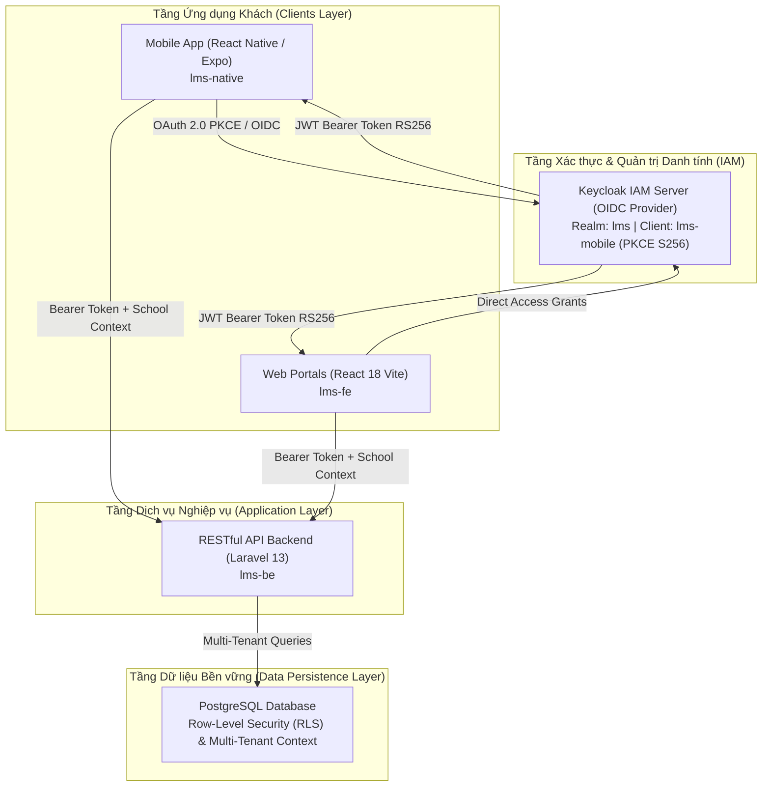
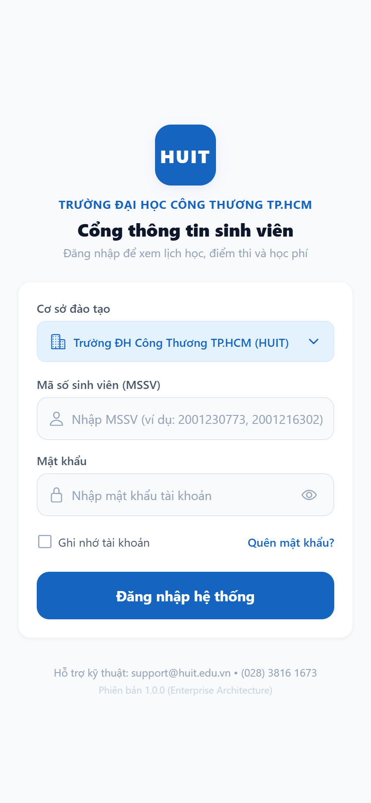
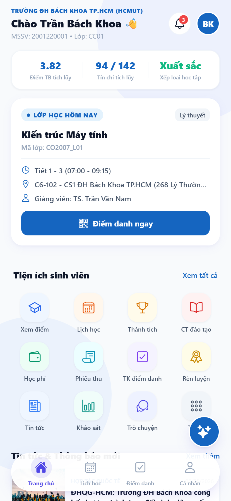
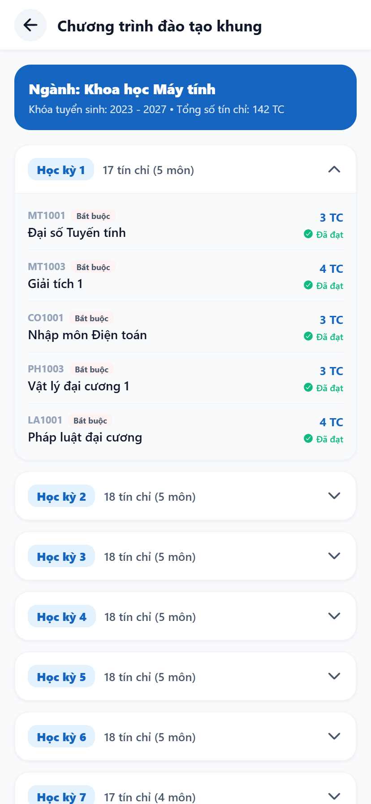
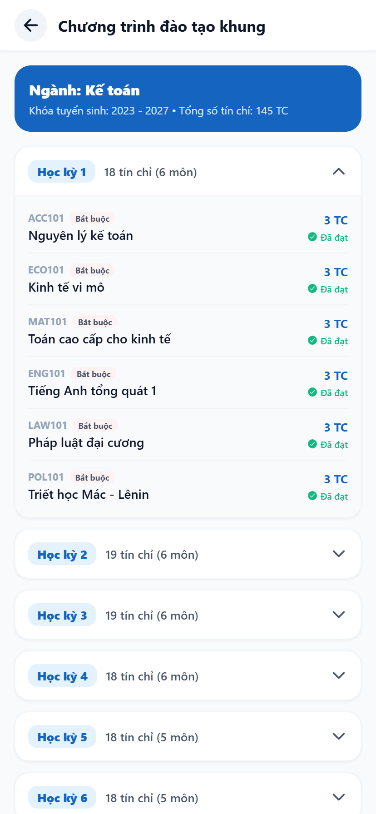
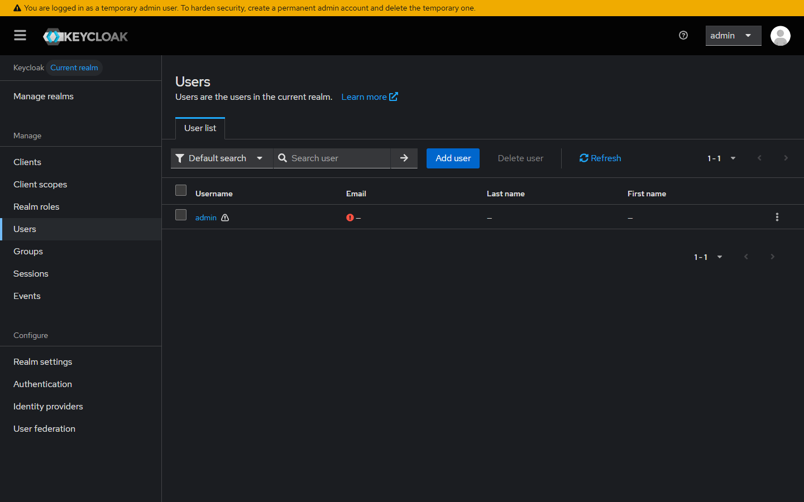
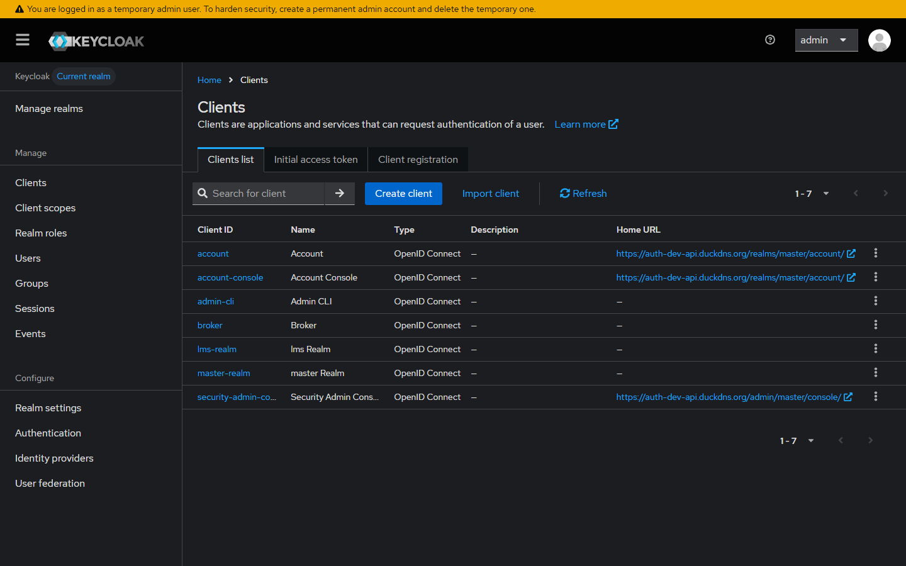
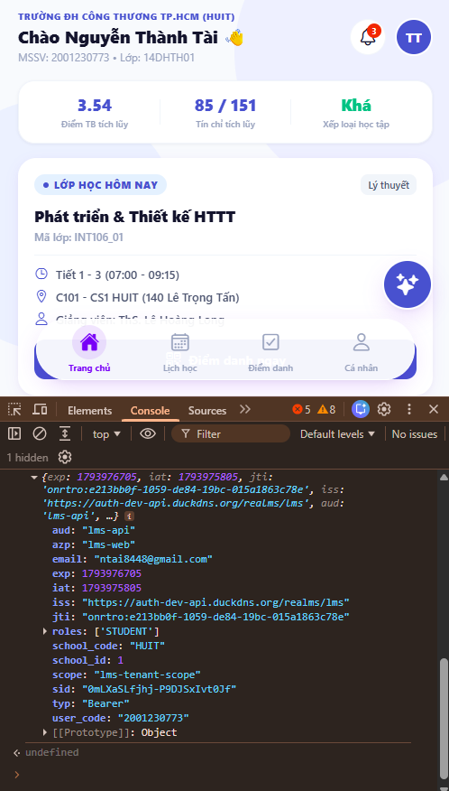
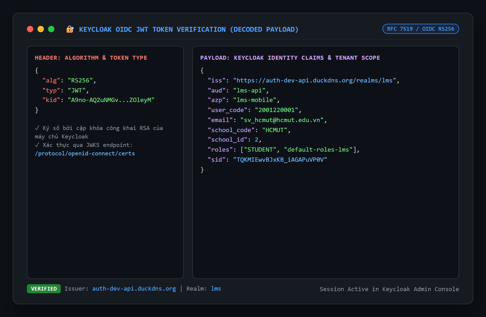

# Enterprise Learning Management System (LMS) Multi-Tenant Platform

Nền tảng Quản lý Học tập và Quản trị Đào tạo Đa trường (Multi-Tenant Learning Management System) phục vụ các trường đại học thành viên, tích hợp hệ thống xác thực tập trung **Keycloak Identity and Access Management (OIDC / PKCE)** và cơ sở dữ liệu **PostgreSQL** hỗ trợ phân vùng dữ liệu theo từng cơ sở đào tạo.

---

## 1. Tổng quan Kiến trúc Hệ thống

Hệ thống được thiết kế theo mô hình kiến trúc phân tầng (Multi-tier Architecture) hỗ trợ Multi-Tenant, bảo đảm sự cô lập dữ liệu hoàn toàn giữa các trường đại học thành viên (Trường ĐH Công Thương TP.HCM - HUIT và Trường ĐH Bách Khoa TP.HCM - HCMUT).



### Các phân hệ chính trong Repository

* **`lms-native`**: Ứng dụng di động dành cho sinh viên và giảng viên, phát triển trên nền tảng React Native (Expo SDK 58), hỗ trợ đa nền tảng (Android, iOS, Web). Tích hợp đăng nhập chuẩn doanh nghiệp qua **Keycloak PKCE (RFC 7636)**.
* **`lms-fe`**: Cổng thông tin web dành cho Quản trị viên hệ thống (SaaS Super Admin), Quản trị viên trường (School Admin), Giảng viên và Sinh viên, xây dựng bằng React 18 và Vite.
* **`lms-be`**: Hệ thống dịch vụ lõi (Core Backend API) phát triển trên nền tảng Laravel 13, cung cấp API RESTful, kết nối PostgreSQL với cơ chế Row-Level Security (RLS) bảo vệ dữ liệu độc lập giữa các trường.

---

## 2. Phân hệ Ứng dụng Di động (`lms-native`)

Phân hệ `lms-native` cung cấp giao diện học vụ hiện đại, tự động nhận diện thương hiệu và dữ liệu đào tạo theo từng trường thành viên.

### 2.1. Tính năng nổi bật

1. **Xác thực an toàn qua Keycloak OIDC PKCE**:
   * Triển khai chuẩn **RFC 7636 Proof Key for Code Exchange (S256)** bảo vệ mã ủy quyền trên thiết bị di động.
   * Giao diện đăng nhập đồng nhất: Một nút bấm chính xử lý phiên làm việc thông suốt.
   * Lưu trữ token an toàn và bền vững qua persistent storage, tự động khôi phục session khi mở lại ứng dụng.
2. **Cô lập dữ liệu Đa trường (Multi-Tenant Isolation)**:
   * Tự động chuyển đổi logo, màu sắc nhận diện, thông tin phòng ban, hotline và kênh hỗ trợ giữa HUIT và Bách Khoa (HCMUT).
   * Cơ chế phòng vệ tự động chặn truy cập trái phép nếu sinh viên chọn sai trường (HTTP 401).
3. **Quản lý Học vụ & Chương trình đào tạo khung**:
   * Đồng bộ trạng thái môn học: Hiển thị nhãn **"Đã đạt"** cho các học phần đã tích lũy; ẩn các nhãn trạng thái dư thừa đối với các học phần chưa học.
   * Mở rộng cấu trúc chương trình đào tạo đủ 8 học kỳ: Ngành Công nghệ thông tin HUIT (151 tín chỉ), ngành Kế toán HUIT (145 tín chỉ), ngành Khoa học Máy tính Bách Khoa HCMUT (142 tín chỉ).
   * Tự động ẩn cảnh báo nợ tín chỉ khi sinh viên không có nợ môn (`creditsDebt = 0`).

---

### 2.2. Hình ảnh Giao diện Thực tế (Visual Proof of Work)

#### Giao diện Đăng nhập Đồng nhất & Trang chủ Học sinh

| Màn hình Đăng nhập Hệ thống (Unified Button) | Trang chủ Bách Khoa (HCMUT) - Nhãn Xuất sắc căn giữa |
| :---: | :---: |
|  |  |

#### Chương trình Đào tạo Khung (Đồng bộ Nhãn "Đã đạt" & Đủ 8 Học kỳ)

| CTĐT Khoa học Máy tính Bách Khoa (8 Kỳ - 142 TC) | CTĐT Kế toán HUIT (8 Kỳ - 145 TC) |
| :---: | :---: |
|  |  |

---

## 3. Xác thực Danh tính & Bảo mật (Keycloak IAM)

Toàn bộ tài khoản người dùng trên hệ thống (Web và Mobile) được quản lý tập trung trên máy chủ Keycloak tại Realm **`lms`**.

### 3.1. Minh chứng Vận hành Keycloak

#### Bảng điều khiển Quản trị Keycloak (Keycloak Admin Console)

| Danh sách Người dùng Realm `lms` (Users List) | Cấu hình Client Di động `lms-mobile` (PKCE S256) |
| :---: | :---: |
|  |  |

#### Phiên làm việc Thực tế & Giải mã JWT Token (Live Decoded Token)

| Minh chứng Token JWT sống trên Mobile App (Console) | Cấu trúc Payload Token RS256 (Claims & Tenant Scope) |
| :---: | :---: |
|  |  |

---

### 3.2. Ma trận Tài khoản Mẫu Kiểm thử (Test Accounts Matrix)

Hệ thống được cấu hình sẵn 9 tài khoản kiểm thử thuộc 4 cấp độ phân quyền với mật khẩu chuẩn ban đầu:

| STT | Vai trò (Role) | Cơ sở đào tạo | Tên đăng nhập | Mật khẩu chuẩn | Họ và tên | Phạm vi phân quyền |
|:---:|---|:---:|---|---|---|---|
| 1 | **Sinh viên** | HCMUT | `2001220001` | `Student@123` | Trần Bách Khoa | KH&KT Máy tính / CC01 (6 môn, TKB Thứ 2 - 7) |
| 2 | **Sinh viên** | HUIT | `2001216302` | `Student@123` | Nguyễn Minh Dũng | Khoa CNTT / 14DHTH02 (5 môn học) |
| 3 | **Sinh viên** | HUIT | `2001216304` | `Student@123` | Phạm Thị Cúc | Khoa Kế toán / 12DHKT01 (4 môn học) |
| 4 | **Sinh viên** | HUIT | `2001230773` | `Student@123` | Nguyễn Thành Tài | Khoa CNTT / 14DHTH01 (4 môn học) |
| 5 | **Giảng viên** | HUIT | `gv001` | `Lecturer@123` | ThS. Lê Hoàng Long | Quản lý giảng dạy, điểm danh lớp học HUIT |
| 6 | **Giảng viên** | HCMUT | `gv_hcmut_01` | `Lecturer@123` | TS. Trần Văn Nam | Quản lý giảng dạy, điểm danh lớp học HCMUT |
| 7 | **School Admin**| HUIT | `ad_huit_01` | `Admin@123` | Quản Trị HUIT | Quản lý cán bộ, phòng học, lớp môn học HUIT |
| 8 | **School Admin**| HCMUT | `ad_hcmut_01` | `Admin@123` | Quản Trị HCMUT | Quản lý chương trình đào tạo, sinh viên HCMUT |
| 9 | **SaaS Admin** | Toàn hệ thống | `sa001` | `SuperAdmin@2024`| Super Administrator| Quản trị cấp cao nhất, quản lý danh mục Tenants |

---

## 4. Cấu trúc Thư mục Dự án

```text
LearningManagementSystem-PHP/
├── .github/
│   ├── workflows/                  # CI/CD Workflows (ci-mobile, ci-backend, ci-frontend)
│   └── screenshots/                # Bộ lưu trữ hình ảnh minh chứng vận hành hệ thống
├── lms-native/                     # Ứng dụng di động React Native / Expo
│   ├── __tests__/                  # Bộ kiểm thử tự động Jest
│   ├── src/
│   │   ├── api/                    # Tầng giao tiếp HTTP Client & Student API
│   │   ├── components/             # Các components dùng chung (Header, Card, Button)
│   │   ├── config/                 # Cấu hình môi trường & Endpoints
│   │   ├── context/                # AuthContext quản lý trạng thái đăng nhập
│   │   ├── screens/                # Màn hình chức năng (Auth, Home, Academic, Profile)
│   │   ├── services/               # Dịch vụ PKCE OIDC và Persistent Storage
│   │   └── types/                  # Định nghĩa kiểu dữ liệu TypeScript
│   ├── App.tsx                     # Điểm khởi chạy ứng dụng
│   ├── package.json
│   └── tsconfig.json
├── lms-fe/                         # Cổng thông tin Web React 18 / Vite
│   ├── src/
│   │   ├── AdminPages/             # Giao diện dành cho SaaS Admin & School Admin
│   │   ├── LecturerPages/          # Giao diện dành cho Giảng viên
│   │   ├── StudentPages/           # Giao diện dành cho Sinh viên
│   │   └── services/               # Dịch vụ xác thực và kết nối API
│   ├── package.json
│   └── vite.config.js
└── lms-be/                         # Dịch vụ Backend Laravel 13
    ├── app/
    │   ├── Http/Controllers/Auth/  # Bộ điều khiển đăng nhập và xác thực Keycloak
    │   ├── Models/                 # Eloquent Models (User, Student, Teacher, School)
    │   └── Services/Auth/          # KeycloakAuthService & JWT Verification
    ├── routes/api.php              # Định tuyến RESTful API
    └── composer.json
```

---

## 5. Hướng dẫn Cài đặt & Vận hành

### 5.1. Yêu cầu Tiền đề (Prerequisites)

* **Node.js**: Phiên bản 20.x hoặc 22.x LTS.
* **NPM**: Phiên bản 10.x trở lên.
* **PHP**: Phiên bản 8.2 trở lên (nếu chạy Backend cục bộ).
* **Composer**: Phiên bản 2.x trở lên.

---

### 5.2. Khởi chạy Ứng dụng Di động (`lms-native`)

```bash
# 1. Di chuyển vào thư mục phân hệ mobile
cd lms-native

# 2. Cài đặt các gói phụ thuộc
npm install

# 3. Kiểm tra tính toàn vẹn kiểu dữ liệu và cú pháp
npx tsc --noEmit
npm run lint

# 4. Thực thi kiểm thử tự động
npm test

# 5. Khởi chạy máy chủ phát triển Expo Web
npx expo start --web
```
Ứng dụng sẽ hoạt động tại địa chỉ: `http://localhost:8081`.

---

### 5.3. Khởi chạy Cổng thông tin Web (`lms-fe`)

```bash
# 1. Di chuyển vào thư mục frontend
cd lms-fe

# 2. Cài đặt các gói phụ thuộc
npm install

# 3. Khởi chạy máy chủ phát triển Vite
npm run dev
```
Cổng thông tin sẽ hoạt động tại địa chỉ: `http://localhost:5173`.

---

## 6. Đảm bảo Chất lượng & Tự động hóa (CI/CD)

Hệ thống tích hợp quy trình kiểm soát chất lượng tự động thông qua GitHub Actions:

| Hạng mục kiểm tra | Lệnh thực thi | Kết quả đạt được | Ý nghĩa kỹ thuật |
|---|---|:---:|---|
| **TypeScript Strict Checking** | `npx tsc --noEmit` | **0 errors** | Đảm bảo tính toàn vẹn kiểu dữ liệu tĩnh |
| **ESLint Quality Standard** | `npm run lint` | **0 warnings / 0 errors** | Chuẩn hóa quy cách mã nguồn React Native |
| **Jest Automated Test Suite** | `npm test` | **3 / 3 test suites passed** | Kiểm chứng logic PKCE S256 và Multi-Tenant |
| **GitHub Actions Pipeline** | Job `lint-and-test` | **Passed (Green)** | Tự động kiểm tra chất lượng trên runner đám mây |
| **API Cross-Tenant Security** | `test_all_accounts.py` | **11 / 11 passed (100%)** | Xác nhận 100% tài khoản qua Keycloak và cách ly trường |

```text
✓ PASS __tests__/App.test.tsx
  LMS Mobile App Suite - Keycloak PKCE & Multi-Tenant
    ✓ passes sanity check (2 ms)
    ✓ generates valid Keycloak PKCE authorization URL with RFC 7636 parameters (8 ms)
    ✓ handles multi-tenant student profiles for both HUIT and HCMUT (210 ms)

Test Suites: 1 passed, 1 total
Tests:       3 passed, 3 total
```

---

## 7. Giấy phép & Phân quyền (License)

Dự án được phát triển phục vụ mục đích học tập và nghiên cứu trong khuôn khổ môn học Mã nguồn mở PHP / Laravel. Bản quyền thuộc về Nhóm dự án LMS.
